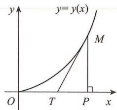

(7) 设曲线 $(x^{2} + y^{2})^{\frac{3}{2}} = 2\sqrt{2}xy, x \geqslant 0, y \geqslant 0$ 所围区域为 $D$ ，计算 $I = \iint_{D} (x + 2\sqrt{xy} - y)^{2} \mathrm{d}x \mathrm{~d}y$ .

(8) 设 $D = \{(x, y) \mid x^4 + y^4 \leqslant 1, x \geqslant 0, y \geqslant 0\}$ , 计算 $I = \iint_{D} (x^2 + xy - y^2) \, \mathrm{d}x \, \mathrm{d}y$ .

(9) 计算积分 $I = \int_{0}^{1} dx \int_{1 - x}^{2 - x} e^{(x + y)^2} (\sin^2 x + \cos^2 y) dy + \int_{1}^{2} dx \int_{0}^{2 - x} e^{(x + y)^2} (\sin^2 x + \cos^2 y) dy.$

(10) 计算 $I = \int_{-\sqrt{\frac{\pi}{2}}}^{\sqrt{\frac{\pi}{2}}} dx \int_{|x|}^{\sqrt{\pi - x^2}} e^{-(x^2 + y^2)} \sin (x^2 + y^2) dy.$

(11) 求极限 $\lim_{t\to 0^{+}}\frac{1}{t^6}\int_0^t dx\int_x^t\sin (xy)^2\mathrm{d}y.$

(12) 设 $D_{t}=\left\{(x,y)\mid0\leqslant x\leqslant2t,0\leqslant y\leqslant t,t>0\right\}$ , $f(x,y)$ 在 $D_{t}$ 上有二阶连续偏导数, 求 $F(t)=\iint_{D_{t}}f''_{yx}(x,y)\mathrm{d}x\mathrm{d}y$ , 并计算 $\lim_{t\to0^{+}}\frac{F(t)}{t}$ .

(13) 设 $D = \left\{(\theta, r) \mid 0 \leqslant \theta \leqslant \frac{\pi}{2}, 0 \leqslant r \leqslant 1\right\}$ , 计算 $I = \iint_{D} r^{3} e^{r^{2} \cos 2\theta} \sin 2\theta d\theta dr$ .

(14) 设 $D = \{(x, y) \mid x^2 + y^2 \leqslant 1, 0 \leqslant y \leqslant x\}$ , 计算 $I = \iint_{D} \frac{xy}{1 + x^2 - y^2} \, \mathrm{d}x \, \mathrm{d}y$ .

(15) 设 $D = \{(x, y) \mid 0 \leqslant x \leqslant 1, 0 \leqslant y \leqslant x\}$ , 计算 $I = \iint_{D} \arcsin \left(2\sqrt{x - x^2}\right) \mathrm{d}x \mathrm{d}y$ .

(16) 设可导函数 $f(x)$ 满足 $\lim_{x\to 0}\frac{f(x)}{x} = 1$ , 求极限 $\lim_{t\to 0^{+}}\frac{\int_{0}^{t}dx\int_{-\sqrt{t^2 - x^2}}^{\sqrt{t^2 - x^2}}[f(\sqrt{x^2 + y^2}) + 2y]\mathrm{d}y}{t^3}$ .

(17) 设 $F(t)=\left\{\begin{aligned}&\iint_{x^{2}+y^{2}\leqslant t^{2}}\left[1-\frac{F\left(\sqrt{x^{2}+y^{2}}\right)}{x^{2}+y^{2}}\right]\mathrm{d}x\mathrm{d}y,&t>0,\\ &x\geqslant0,y\geqslant0\\ &0&t=0\end{aligned}\right.$ 在 $[0,+\infty)$ 上连续，求函数 $F(t)$ 的表达式.

(18) 设 $f(t)$ 在 $(-\infty, +\infty)$ 内有连续导数，且 $f(t) = 2 \iint_{D} (x^{2} + y^{2}) f\left(\sqrt{x^{2} + y^{2}}\right) \mathrm{d}x \, \mathrm{d}y + t^{4}, D: x^{2} + y^{2} \leqslant t^{2}$ ，求 $f(t)$ .

(19) 设 $f(x, y)$ 在区域: $0 \leqslant x \leqslant 1, 0 \leqslant y \leqslant 1$ 上连续, $f(0, 0) = 0$ , 且 $f(x, y)$ 在点 $(0, 0)$ 处可微, $f_y'(0, 0) = 1$ , 求 $\lim_{x \to 0^+} \frac{\int_0^{x^2} dt \int_x^{\sqrt{t}} f(t, u) du}{1 - e^{-\frac{x^4}{4}}}$ .

(20) 设 $D: x^{2} + y^{2} \leqslant 4, x \geqslant 0, y \geqslant 0, f(x, y)$ 在 $D$ 上连续，且

$$
f (x, y) = \left(x ^ {2} + y ^ {2} - x + y - 1\right) + \iint_ {D} f (u, v) d u d v,
$$

求 $f(x,y)$ .

(21) 设 D 是由 $y=\sqrt{1-x^{2}}$ , $y=\sqrt{4-x^{2}}$ 与 $x+y=0$ 及 x 轴所围，且位于 $x+y\geqslant0$ 部分的区域，计算 $I=\iint_{D}\frac{\sqrt{x^{2}+y^{2}}}{x^{2}+2y^{2}}\mathrm{d}x\mathrm{d}y.$

(22) 设 $D = \{(x, y) \mid 4 \leqslant x^2 + y^2 \leqslant 9, x \geqslant 0, y \geqslant 0\}$ , $f(x, y)$ 在 $D$ 上连续, 且

$$
f (x, y) = \sin \left(\pi \sqrt {x ^ {2} + y ^ {2}}\right) + \frac {1}{\pi} \iint_ {D} \frac {x f (x , y)}{x + y} d x d y.
$$

求 $I=\iint_{D}f(x,y)\mathrm{d}x\mathrm{d}y.$

(23) 设 $f(x)$ 在 $[0,1]$ 上是连续正值函数，且 $f(x)$ 单调减少， $D:0 \leqslant x \leqslant 1, 0 \leqslant y \leqslant 1$ ，证明： $\iint_{D} x f(x) f(y) [f(x) - f(y)] \mathrm{d}x \mathrm{d}y \leqslant 0.$

(24) 设 $f(u)$ 在 $[-1, 1]$ 上连续, $D: |x| + |y| \leqslant 1$ , 证明: $\iint_{D} f(x + y) \, \mathrm{d}x \, \mathrm{d}y = \int_{-1}^{1} f(u) \, \mathrm{d}u$ .

(25) 设 $D: x^{2} + y^{2} \leqslant 2tx, y \geqslant 0 (t > 0), f(u)$ 在 $u = 0$ 处可导, 且 $f(0) = 0$ , 求

$$
\lim _ {t \rightarrow 0 ^ {+}} \frac {1}{t ^ {4}} \iint_ {D} f (\sqrt {x ^ {2} + y ^ {2}}) y d x d y.
$$

## 拓展题

## 解答题

(1) 设 D 是由曲线 $\left\{\begin{aligned} x &= 1 - \cos t, \\ y &= t - \sin t \end{aligned}\right.$ ( $0 \leqslant t \leqslant 2\pi$ ) 与 y 轴所围平面区域, 计算 $I = \iint_{D} (2x + y) \, \mathrm{d}x \, \mathrm{d}y$ .

(2) 设 $D = \{(x, y) | x^2 + y^2 \leqslant 4\}$ , 计算 $I = \iint_{D} |2x - x^2 - y^2| \, \mathrm{d}x \, \mathrm{d}y$ .

(3) 设平面曲线 $L: |\ln x| + |\ln y| = 1$ 所围区域为 $D$ ，计算 $I = \iint_{D} (x - y + 1) \, \mathrm{d}x \, \mathrm{d}y$ .

(4) 设在第一象限内, $x^{2} + y^{2} = \frac{1}{4}$ 与 $x^{2} + y^{2} = x^{4} + y^{4}$ 及 $x = 0, y = 0$ 所围区域为 $D$ . 计算 $I = \iint_{D} \frac{xy}{x^{2} + y^{2}} \, \mathrm{d}x \, \mathrm{d}y$ .

(5) 设 $f(x)$ 有连续导数, $f(x)$ 不恒为零, 且 $\int_{0}^{1} f(x) \mathrm{d}x = 0$ , 记 $M = \max_{x \in [0,1]} |f'(x)|$ .

(I) 证明: 对 $\forall x \in [0,1]$ , 有 $|f(x)| \leqslant \frac{1}{2} M$ ;

(II) 设 $D = \{(x, y) \mid 0 \leqslant x \leqslant 1, 0 \leqslant y \leqslant x\}$ , 证明: $\left|\iint_{D} f(y) \mathrm{d}x \mathrm{d}y\right| \leqslant \frac{1}{8} M$ .

## 第六章 微分方程及其应用

## 基础题

## 一、选择题

(1)下列选项中(C为任意常数)，是微分方程 $\frac{dy}{dx}+\frac{x}{y}=0$ 通解的是()。
A. $x^{2}+y^{2}=C^{2}$ B. $x^{2}-y^{2}=C^{2}$ C. $x^{2}+y^{2}=C$ D. $x^{2}-y^{2}=C$

(2) 设 $y' + P(x)y = 0$ 的一个特解为 $y = \cos 2x$ ，则该方程满足 $y(0) = 2$ 的特解为（）.
A. $2\cos x$ B. $2\cos 2x$ C. $\cos 2x$ D. $\cos 2x + 1$

(3) 微分方程 $y'' + 2y' - 3y = e^{-x} + x$ 的一个特解形式为（）.
A. $ae^{-x} + bx + c$ B. $axe^{-x} + x(bx + c)$ C. $axe^{-x} + bx + c$ D. $ae^{x} + x(bx + c)$

(4) 设 $y_{1}(x), y_{2}(x)$ 是 $y' + P(x)y = 0$ 的两个不同特解, 其中 $P(x)$ 在 $(-∞, +∞)$ 内连续, 且 $P(x)$ 不恒为 0, 则下列结论错误的是 ( ).  
A. $y_{1}(x) - y_{2}(x) = \text{常数}$ B. $C[y_{1}(x) - y_{2}(x)]$ 是方程的通解
C. $y_{1}(x)-y_{2}(x)$ 在任一点不为 0
D. $\frac{y_{2}(x)}{y_{1}(x)}\equiv\text{常数}\left(y_{1}(x)\neq0\right)$

(5) 设 $y_{1}(x), y_{2}(x), y_{3}(x)$ 是微分方程 $y'' + p(x)y' + q(x)y = f(x)$ 的三个线性无关的解, $f(x) \neq 0$ , 则该方程的通解为 ( ).  
A. $C_{1}y_{1}(x) + C_{2}y_{2}(x) + y_{3}(x)$ B. $C_{1}y_{1}(x) + (1 - 2C_{1})y_{2}(x) + C_{1}y_{3}(x)$ C. $(C_{1}-C_{2})y_{1}(x)+C_{2}y_{2}(x)+y_{3}(x)$ D. $C_{1}y_{1}(x)+C_{2}y_{2}(x)+C_{3}y_{3}(x)(C_{1}+C_{2}+C_{3}=1)$

(6) 设 $y_{1}=e^{-x}, y_{2}=2x$ 是常系数齐次线性微分方程 $y'''+ay''+by'+cy=0$ 的两个解，则该方程的通解是（）.
A. $c_{1}e^{-x} + c_{2} + c_{3}x$ B. $c_{1}e^{-x} + c_{2}e^{x} + c_{3}x$ C. $c_{1}e^{-x} + c_{2}e^{x} + c_{3}$ D. $c_{1}e^{-x} + c_{2}xe^{x} + c_{3}$

(7) 设 $f(x)$ 在 $[0, +\infty)$ 上可导， $\lim_{x \to +\infty} f(x) = b (b \neq 0)$ ， $y(x)$ 为方程 $y' + ay = f(x) (a > 0)$ 的任一解，则 $y = y(x)$ 有水平渐近线（）.
A. y = ab B. y = -ab C. $y = \frac{b}{a}$ D. $y = \frac{a}{b}$

## 二、填空题

(1) 微分方程 $(y - x \sin x) \, dx + x \, dy = 0$ 的通解为 \_\_\_\_.

(2) 微分方程 $(1+y^{2})\mathrm{d}x+(2x-1)y\mathrm{d}y=0$ 的通解为 \_\_\_\_.

(3) $y'=\frac{y}{x}+\tan\frac{y}{x}$ 满足 $y(1)=\frac{\pi}{6}$ 的特解为 \_\_\_\_.

(4) 微分方程 $xy' = \sqrt{x^{2} + y^{2}} + y$ 的通解为 \_\_\_\_.

(5) 方程 $y'' + 2y' + y = xe^{x}$ 满足 $y(0) = 0, y'(0) = 0$ 的特解为 \_\_\_\_.

(6) 方程 $y'' - 3y' + 2y = 10e^{-x}\sin x$ 满足当 $x \to +\infty$ 时， $y(x) \to 0$ 的特解为 \_\_\_\_.

(7) 方程 $(1-x^{2})y''-xy'=0$ 满足 $y(0)=0, y'(0)=1$ 的特解为 \_\_\_\_.

(8) 设二阶线性非齐次微分方程 $y'' + p(x)y' + q(x)y = f(x)$ 有三个特解为 $x, e^{x}, e^{-x}$ ，则该方程的通解为 \_\_\_\_.

(9) 设二阶常系数线性微分方程 $y'' + ay' + by = ce^{x}$ 有特解 $y^{*} = e^{-x}(1 + xe^{2x})$ ，则该方程的通解为 \_\_\_\_.

## 三、解答题

(1) 求 $x^{2}y'' - y'^{2} = 0$ 过点 $P(1,0)$ ，且在点 P 与 y = x - 1 相切的积分曲线.

(2) 设 $f(x)$ 是连续函数，且 $f(x) = \cos x - \int_{0}^{x} (x - t)f(t)dt$ ，求 $f(x)$ .

(3) 设 $f(x)$ 可导, 对任何实数 x, y 满足 $f(x + y) = \mathrm{e}^{x} f(y) + \mathrm{e}^{y} f(x)$ , 且 $f'(0) = \mathrm{e}$ , 求 $f(x)$ .

(4) 求微分方程 $y''' - y' = 0$ 的一条积分曲线，使此积分曲线在原点处有拐点，且以直线 y = 2x 为切线.

(5) 设 $f(u)$ 有二阶连续导数, $z = f\left(\sqrt{x^2 + y^2}\right)$ 满足 $\frac{\partial^2z}{\partial x^2} + \frac{\partial^2z}{\partial y^2} = x^2 + y^2$ , 求 $z$ 的表达式.

(6) 设 $f(u)$ 在 $(0, +\infty)$ 内具有二阶导数, $z = xf\left(\frac{y}{x}\right) + yf\left(\frac{y}{x}\right)$ 满足

$$
x \frac {\partial^ {2} z}{\partial x \partial y} + 2 y \frac {\partial^ {2} z}{\partial y ^ {2}} = \frac {y}{x}, z (x, x) = x, \left. \frac {\partial z}{\partial x} \right| _ {(x, x)} = - \frac {3}{2}.
$$

求 $f(u)$ .

(7) 利用变换 $u = e^{x}$ ，求微分方程 $y'' - (2e^{x} + 1)y' + e^{2x}y = e^{3x}$ 的通解.

(8) 设 L 是一条平面曲线, 其上任意一点 $P(x,y)$ (x > 0) 到原点的距离恒等于该点处的切线在 y 轴上的截距, 且 L 过点 $\left(\frac{1}{2}, 0\right)$ . 求:

(I) 曲线 L 的方程;

(II)L位于第一象限部分的一条切线,使该切线与L以及两坐标轴所围的面积最小.

(9) 设 $\hat{OA}$ 是连接 $O(0,0)$ 和 $A(1,1)$ 的一段向上凸的曲线弧, $P(x,y)$ 为 $\hat{OA}$ 上任一点, 曲线弧 $\hat{OP}$ 与有向线段 $\overline{OP}$ 所围图形的面积为 $x^{2}$ , 求曲线弧 $\hat{OA}$ 的方程.

(10) 设 $y = y(x)$ 满足 $xy' - (2x^2 - 1)y = x^3 (x \geqslant 1), y(1) = a$ .

(I) 求 $y(x)$ ;

(II) 若 $\lim_{x\to+\infty}\frac{y(x)}{x}$ 存在, 求曲线 $y=y(x)$ 的斜渐近线方程.

(11) 设 $f(x)$ 满足 $xf'(x) - f(x) = a(1 - \ln x) + x^{2} (x > 0, a \neq 0), f(1) = 1 - a.$

(I) 求 $f(x)$ 的表达式;

(II) 若方程 $f(x)=0$ 在 $x\in(0,+\infty)$ 内有唯一实根, 求 a 的取值范围.

## 综合题

## 一、选择题

(1) 下列方程中，以 $y = C_{1} e^{x} + C_{2} \cos x + C_{3} \sin x (C_{1}, C_{2}, C_{3}$ 为任意常数) 为通解的是 ( ) .
A. $y''' - y'' + y' - y = 0$ B. $y''' + y'' + y' - y = 0$ C. $y''' + y'' - y' - y = 0$ D. $y''' - y'' - y' - y = 0$

(2) 若二阶常系数线性齐次微分方程 $y'' + py' + qy = 0$ 的通解为 $y = C_{1}e^{x} + C_{2}xe^{x}$ ，则非齐次微分方程 $y'' + py' + qy = x$ 满足 $y(0) = 2, y'(0) = 0$ 的特解为 $y = (\quad)$ .
A. $xe^{x}-x-2$ B. $xe^{x}-x+2$ C. $-xe^{x}+x+2$ D. $-xe^{x}-x+2$

(3) 设 C 为任意常数，则以 $y = e^{Cx + x^{2}}$ 为通解的一阶微分方程为（）.
A. $xy' - y\ln y = x^{2}y$ B. $xy' + y\ln y = xy^{2}$ C. $xy' - y\ln y^{2} = xy$ D. $xy' + y\ln y = xy$ (4) 设 $y_{1}, y_{2}$ 是一阶线性非齐次微分方程 $y' + P(x)y = Q(x)$ 的两个解，若常数 $\lambda, \mu$ ，使得 $\lambda y_{1} + \mu y_{2}$ 是该方程的解， $\lambda y_{1} - \mu y_{2}$ 是对应的齐次微分方程的解，则（）.
A. $\lambda=-\frac{1}{2},\mu=-\frac{1}{2}$ B. $\lambda=\frac{1}{2},\mu=\frac{1}{2}$ C. $\lambda=\frac{1}{3},\mu=\frac{2}{3}$ D. $\lambda=\frac{2}{3},\mu=\frac{2}{3}$

(5) 设 $y_{1}(x)$ 与 $y_{2}(x)$ 是非齐次微分方程 $y' + P(x)y = Q(x)$ 的两个解. 若 $\lambda y_{1}(x) + \mu y_{2}(x)$ 仍是该方程的解，则 $e^{\lambda^{3} + \mu^{3}}$ 的最小值为 ( ). A. $e^{-1}$ B. $e^{\frac{1}{2}}$ C. $e^{\frac{1}{4}}$ D. $e^{\frac{1}{3}}$

(6) 设 $y = y(x)$ 是 $y'' + ay' + by = 0$ 的解, 其中 a, b 为正常数, 则 ( ).  
A. $\lim_{x \to +\infty} y(x) = 0$ B. $\lim_{x \to +\infty} y(x) = +\infty$ C. $\lim_{x \to +\infty} y(x) = -\infty$ D. $\lim_{x \to +\infty} y(x)$ 不存在, 且不为 $\infty$ (7) 设 $f(x)$ 是定义在 R 上的偶函数, 且 $f(x) + f'(x) = 2\mathrm{e}^{x}$ , 若 $a[f(x) - \mathrm{e}^{x}] \leqslant x$ 在 R 上恒成立, 则 a 的取值范围为 ( ).  
A. $(-∞,0]$ B. $\left(-∞,-\frac{1}{\mathrm{e}}\right]$ C. $(-∞,-1)$ D. $(-∞,-\mathrm{e}]$

## 二、填空题

(1) 微分方程 $y' = \frac{y}{x + (y + 1)^2}$ (y 不为常函数) 的通解为 \_\_\_\_.

(2) 微分方程 $y'' - y = \sin x$ 满足 $y(0) = 0, y'(0) = \frac{3}{2}$ 的特解为 \_\_\_\_.

(3) 微分方程 $y' = \frac{y^{2} - x}{2y(x + 1)}$ 的通解为 \_\_\_\_.

(4) 微分方程 $\frac{dy}{dx} = \frac{y - x}{y + x}$ 满足 $y(1) = 0$ 的特解为 \_\_\_\_.

(5) 微分方程 $y'\sec^{2}y + \frac{x}{1 + x^{2}}\tan y = x$ 满足 $y(0) = 0$ 的特解为 \_\_\_\_.

(6) 微分方程 $y'' + y = x + \cos x$ 的通解为 \_\_\_\_.

(7) 微分方程 $y'' - y = \sin^{2}x$ 的通解为 \_\_\_\_.

(8) 设 $f(x)$ 有连续导数, 对任意 a 满足 $f(x+a)=\int_{x}^{x+a}\frac{t(t^{2}+1)}{f(t)}dt+f(x)$ , 且 $f(1)=\sqrt{2}$ , 则 $f(x)=$ \_\_\_\_.

(9) 设函数 $y(x)$ 满足 $y'' + 2ay' + b^{2}y = 0 (a > b > 0)$ ，且 $y(0) = 1, y'(0) = 1$ ，则 $\int_{0}^{+\infty} y(x) dx =$ \_\_\_\_ .

(10) 设微分方程 $y'' + ay' + y = 0$ 的每一个解 $y(x)$ 在 $[0, +\infty)$ 上有界，则实数 a 的取值范围为 \_\_\_\_.

## 三、解答题

(1) 设 $f(x)$ 满足 $f(x + y) = \frac{f(x) + f(y)}{1 - f(x)f(y)}$ ，且 $f'(0)$ 存在，求 $f'(x)$ 及 $f(x)$ .

(2) 设 $y = y(x)$ 满足 $x^{2}y' + y = x^{2}\mathrm{e}^{\frac{1}{x}} (x > 0)$ ，且 $y(1) = 3\mathrm{e}$ .

(I) 求 $y = y(x) (x > 0)$ 的全部渐近线方程;

(II) 讨论曲线 $y = y(x) (x > 0)$ 与 $y = k (k > 0)$ 不同交点的个数.

(3) 利用变量替换 $x = \sin t, y = y(t) \left(0 < t < \frac{\pi}{2}\right)$ 化简方程 $(1 - x^2) \frac{d^2y}{dx^2} - x \frac{dy}{dx} + y = 0$ , 并求该方程的通解.

(4) 设微分方程 $\frac{d^{2}y}{dx^{2}} + \frac{dy}{dx} + e^{-2x}y = e^{-3x}$ .

(I) 利用变换 $t = e^{-x}$ 将微分方程化为 y 关于 t 的方程, 并求原方程的通解 $y(x)$ ;

(II) 若 (I) 中的 $y(x)$ 满足 $\lim_{x \to +\infty} y(x) = 1, y(0) = 1$ , 求 $y(x)$ .

(I) 若视 x 为因变量, y 为自变量, 化简该方程;

(5) 设 $y'' + (4x + e^{2y})y'^{3} = 0.$

(Ⅱ) 求该方程的通解.

(6) 设二阶常系数非齐次线性微分方程 $y'' + ay' + by = (cx + d)e^{2x}$ 有特解 $y = 2e^{x} + (x^{2} - 1)e^{2x}$ ，求该方程的通解，并求 a, b, c, d 的值.

(7) 设 $y(x)$ 在 $[x_0, +\infty)$ 上有一阶连续导数，且 $\lim_{x \to +\infty} [y'(x) + y(x)] = k$ ，求 $\lim_{x \to +\infty} y(x)$ .

(8) 设 $f(x)$ , $g(x)$ 满足 $f'(x) = g(x)$ , $g(x) = \int_{0}^{x} [1 - f(t)] dt + 1$ , 且 $f(0) = 1$ , 求 $I = \int_{0}^{\frac{\pi}{2}} e^{-x} [g(x) - f(x)] dx$ .

(9) 设 $f'(x) = 1 + \int_{0}^{x} [-6\cos 2t - f(t)] dt$ ，且 $f(0) = 1$ . 计算 $I = \int_{0}^{\pi} \left[ \frac{f(x)}{x + 1} + f'(x) \ln (1 + x) \right] dx$ .

(10) 设 $y = y(x)$ 有一阶连续导数， $y(0) = 1$ ，且满足 $y'(x) + 3\int_{0}^{x} y'(t) dt + 2x\int_{0}^{1} y(xu) du + e^{-x} = 0$ ，求 $y = y(x)$ .

(11) 设 $f(x)$ 有二阶连续导数, 且 $f(x) = \int_{0}^{x} f(1 - t) dt + 1$ , 求 $f(x)$ .

(12) 设 $f(x)$ 在 $(0, +\infty)$ 内有定义， $f'(1) = 1$ ，当 $x, y \in (0, +\infty)$ 时，满足 $f(xy) = yf(x) + xf(y)$ .

(I) 证明: $f(x)$ 在 $(0, +\infty)$ 内可导, 且 $f'(x) = \frac{f(x)}{x} + 1$ ;

(II) 求函数 $f(x)$ 的极值.

(13) 设 $f(x)$ 满足 $f'(x)=\frac{1}{x}f(x)+x\cos x(x>0)$ ，且 $\lim_{x\to0^{+}}\frac{f(x)}{x}=0.$

(I) 求 $f(x)$ 的表达式;

(II) 若 $y=f(x)$ 在 $[0,n\pi]$ 上与 x 轴所围图形的面积为 $A_{n}(n=1,2,\cdots)$ ，求 $\lim_{n\to\infty}\frac{A_{n}}{(n+1)^{2}}$ .

(14) 设 $f(x)$ 满足 $\mathrm{e}^{f(x)}[f'(x)-1]=x-1(x\geqslant0), f(0)=0$ ，数列 $\{a_{n}\}$ 满足 $a_{1}=1, a_{n+1}=f(a_{n})$ $(n=1,2,\cdots)$ .

(I) 证明: $\lim_{n\to \infty}a_n$ 存在, 并求其值;

(II) 求 $\lim_{n\to\infty}\frac{a_{n+1}}{a_{n}^{2}}$ .

(15) 设 $f(t)$ 有二阶连续导数, $f(1)=f'(1)=1$ , 在 x>0 的平面区域内, 存在函数 $u(x,y)$ , 使得

$$
\mathrm{d} u (x, y) = \left[ \frac {y ^ {2}}{x} + x f \left(\frac {y}{x}\right) \right] \mathrm{d} x + \left[ y - x f ^ {\prime} \left(\frac {y}{x}\right) \right] \mathrm{d} y.
$$

求 $f(t)$ 及 $f(t)$ 的极值.

(16) 设 $f(t)$ 在 $(0, +\infty)$ 内有二阶连续导数, 记 $g(x, y) = f\left(\frac{y}{x}\right)$ . 若 $g(x, y)$ 满足

$$
x ^ {3} \frac {\partial^ {2} g}{\partial x ^ {2}} + x ^ {2} y \frac {\partial^ {2} g}{\partial x \partial y} + x y ^ {2} \frac {\partial^ {2} g}{\partial y ^ {2}} = y, \text {且} g (y, y) = 1, \left. \frac {\partial g}{\partial y} \right| _ {(y, y)} = \frac {2}{y},
$$

求 $f(t)$ .

(17) 设 $f(x)$ 在 $(- \infty, + \infty)$ 内有连续导数, $f(x) > 0$ , 且满足 $(1 + x^2)f'(x) + 2nxf(x) = 0$ ( $n$ 为大于 1 的正整数), $f(0) = 1$ ,

(I) 求 $f(x)$ ;

(II) 记 $S_{n}$ 为曲线 $y = f(x)$ 与 $x$ 轴之间的无界区域的面积, 求 $\lim_{n\to \infty}\left(\frac{S_n}{S_{n - 1}}\right)^n.$

(18) 设 $f(x)$ 在 $[0,1]$ 上有连续导数, $f(0) = 1, f_{+}^{\prime}(0) = 1$ , 且

$$
\iint_ {D} f ^ {\prime \prime} (x + y) \mathrm{d} x \mathrm{d} y = \iint_ {D} [ f (x + y) + (x - y) ^ {3} ] \mathrm{d} x \mathrm{d} y.
$$

其中 $D = \{(x,y) \mid 0 \leqslant y \leqslant t - x, 0 \leqslant x \leqslant t\} (0 < t \leqslant 1)$ , 求 $f(x)$ .

(19) 设 $f(x)$ 满足 $f'(x) + f(x) = e^{-x}, f(0) = 0.$

(I) 求 $y = f(x)$ 的极值与拐点;

(II) 当 $0 < x_{1} < 1 < x_{2}$ 时, 有 $f(x_{1}) = f(x_{2})$ , 证明: $x_{1} + x_{2} > 2$ .

(20) 设上凸曲线 $y = y(x) (y > 0)$ 上任一点 $M(x, y)$ 处的切线与 x 轴交于点 N，且满足 $|OM| = |ON|$ ， $y(0) = 1, y'(x) > 0$ ，求 $y = y(x)$ .

(21) 设 $y = y(x)$ 是向上凸的连续曲线，其上任一点 $(x, y)$ 处的曲率为 $\frac{1}{\sqrt{1 + y'^{2}}}$ ，且此曲线上点
(0,1)处的切线方程为 $y=x+1$ ，求该曲线的方程.

(22) 设曲线 $y = y(x)(y > 0)$ 在点 (0,2) 处有水平切线，曲线上任一点 $(x,y)$ 处的曲率

$$
K = \frac {1}{2 \sqrt {2}} \frac {1}{\sqrt {y} \left(1 + y ^ {\prime 2}\right)}, y ^ {\prime \prime} (x) > 0.
$$

记 $y=y(x), x=0, x=2$ 及 x 轴所围图形为 D，求 $y=y(x) (x \geqslant 0)$ ，并求 D 绕 x=2 旋转一周所得旋转体的体积.

(23) $(I)$ 设 $a(t)$ 在 $[0, +\infty)$ 上是非负连续函数，证明：当且仅当 $\int_0^{+\infty} a(t) dt$ 发散时，微分方程 $\frac{\mathrm{d}x}{dt} + a(t)x = 0$ 的每一个解 $x(t)$ 满足 $\lim_{t \to +\infty} x(t) = 0$ ;

(II) 设 $a > 0, f(t)$ 在 $[0, +\infty)$ 上连续有界, 证明: 方程 $\frac{\mathrm{d}x}{dt} + ax = f(t) (t \geqslant 0)$ 的所有解在 $[0, +\infty)$ 上有界.

(24) 设曲线 $y = y(x)$ 有二阶连续导数， $y''(x) > 0$ ，其上任意一点 $(x, y)$ 处的曲率 $K = \frac{1}{2y^{2}\cos\alpha} (\cos\alpha > 0)$ ，其中 $\alpha$ 为该曲线在相应点处的切线的倾角，且该曲线在点 $(1,1)$ 处取得极小值，求曲线 $y = y(x)$ .

(25) 设函数 $y(x)(x \geqslant 0)$ 二阶可导, 且 $y'(x) > 0, y(0) = 1$ , 过曲线 $y = y(x)$ 上任一点 $P(x, y)$ 作曲线的切线及 x 轴的垂线, 上述两条直线与 x 轴所围三角形的面积记为 $S_{1}$ , 区间 $[0, x]$ 上以 $y = y(x)$ 为曲边的曲边梯形的面积记为 $S_{2}$ , 且 $2S_{1} - S_{2} = 1$ , 求曲线 $y = y(x)$ .

(26) 设在第一象限内的曲线 $y = y(x)$ 满足 $y(0) = 0$ ，且 $y'(x) > 0$ ，曲线上任一点 $M(x, y)$ 处的切线段为 $\overline{MT}$ ，点 M 到 x 轴的垂线为 $\overline{PM}$ ，如图所示， $\triangle PMT$ 的面积与曲边三角形 OPM 的面积之比恒为常数 $k\left(k > \frac{1}{2}\right)$ . 求 $y = y(x)$ .

(27) 设 $y(x)$ 在 $[0, +\infty)$ 上有二阶连续的导数，点 $P(x, y) (x > 0)$ 为凹曲线 $y = y(x)$ 上任意一点，沿曲线从点 $(0, 1)$ 到点 $P(x, y)$ 的弧长在数值上等于该曲线在点 $P(x, y)$ 处的切线的斜率，且曲线在点 $(0, 1)$ 处有水平切线.

(I) 求 $y = y(x)$ 的表达式;

(II) 求曲线 $y = y(x)$ 从点 $\left(\ln 2, \frac{5}{4}\right)$ 到点 $\left(\ln 3, \frac{5}{3}\right)$ 的一段弧长.

(28) 一架质量为 $4.5t$ 的歼击机以 $600 \mathrm{~km} / \mathrm{h}$ 的航速开始着陆，在减速伞的作用下滑跑 $500m$ 后速度减为 $100 \mathrm{~km} / \mathrm{h}$ ，设减速伞的阻力与飞机的速度成正比，忽略飞机所受的其他外力，求减速伞的阻力系数。若保障飞机安全着陆，跑道长度至少应为多少？

(29) 设一单位质量的质点沿 $x$ 轴正向运动, 所受力为 $F(x) = -2\sin 2x$ , 质点的初始位置为原点, 初速度为 2. 求位移函数 $x = x(t)$ ( $t$ 表示时间), 并求质点运动的最远距离.

## 拓展题

## 解答题

(1) 设环境保持恒定温度 $20^{\circ} C$ ，有一物体的温度在 $10 s$ 内从 $100^{\circ} C$ 降到 $60^{\circ} C$ ，若物体温度下降的速度与该物体温度与环境温度之差成正比，问此物体从温度 $100^{\circ} C$ 降到 $25^{\circ} C$ 需要多少时间？

(2) 设 $f(t)$ 在 $[0, +\infty)$ 上连续，且满足 $f(t) = \mathrm{e}^{4\pi t^2} + \iint_{x^2 + y^2 \leqslant 4t^2}\left[x^2 - y^2 + f\left(\frac{1}{2}\sqrt{x^2 + y^2}\right)\right]\mathrm{d}x\mathrm{d}y.$

(I) 求 $f(t)$ ;

(II) 求 $\lim_{t\to0^{+}}[f(t)]^{\frac{1}{t^{2}}}$ .

(3) 设 $y_{1}=x, y_{2}=x u(x)$ 是微分方程 $(x^{2}\ln x)y''-xy'+y=0(x>0)$ 的两个解, 若 $u(1)=1, u(\mathrm{e}^{-1})=0$ , 求 $u(x)$ , 并求该方程的通解.